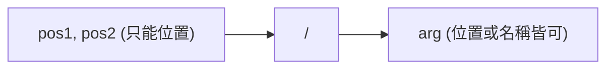
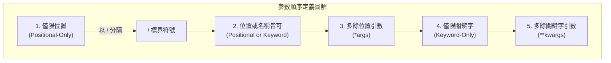

# Python 函式呼叫與引數傳遞完全指南

在 Python 中，定義函式（Function）與呼叫函式是程式設計的核心基礎。本講義專門針對**如何呼叫函式**、**引數傳遞的不同方式**，以及 Python 中常見的特殊符號（`*`、`**`、`/`）進行深入解析。

---

## 目錄
1. [核心觀念：參數 vs 引數](#1-核心觀念參數-vs-引數)
2. [基本呼叫方式](#2-基本呼叫方式)
   - [2.1 位置引數 (Positional Arguments)](#21-位置引數-positional-arguments)
   - [2.2 關鍵字引數 / 名稱引數 (Keyword Arguments)](#22-關鍵字引數--名稱引數-keyword-arguments)
   - [2.3 混合使用規則](#23-混合使用規則)
3. [特殊符號的意義與用法](#3-特殊符號的意義與用法)
   - [3.1 斜線符號 `/`：僅限位置引數 (Positional-Only)](#31-斜線符號--僅限位置引數-positional-only)
   - [3.2 單星號 `*`：收集位置引數、強制關鍵字引數與解包](#32-單星號-收集位置引數強制關鍵字引數與解包)
   - [3.3 雙星號 `**`：收集關鍵字引數與字典解包](#33-雙星號-收集關鍵字引數與字典解包)
4. [終極完整結構：參數定義的標準順序](#4-終極完整結構參數定義的標準順序)
5. [常見錯誤與除錯指南 (Common Errors)](#5-常見錯誤與除錯指南-common-errors)
6. [速查總結表](#6-速查總結表)

---

## 1. 核心觀念：參數 vs 引數

在討論呼叫函式前，先釐清兩個極易混淆的名詞：

- **參數 (Parameter / 形參)**：**定義函式時**宣告的變數名稱（規格）。
- **引數 (Argument / 實參)**：**呼叫函式時**實際傳遞進去的資料數值。

```python
# 定義函式：name 和 age 是「參數 (Parameters)」
def introduce(name, age):
    print(f"大家好，我是 {name}，今年 {age} 歲。")

# 呼叫函式："Alice" 和 20 是「引數 (Arguments)」
introduce("Alice", 20)
```

---

## 2. 基本呼叫方式

### 2.1 位置引數 (Positional Arguments)
依照定義時的**排列順序**，一一對應傳遞引數。

- 第一個引數對應第一個參數，第二個引數對應第二個參數，依此類推。
- **特點**：寫法簡短，但必須嚴格遵守順序，若順序顛倒可能造成邏輯錯誤。

```python
def describe_pet(animal_type, pet_name):
    print(f"我有一隻 {animal_type}，名字叫 {pet_name}。")

# 正確按照順序傳入
describe_pet("小狗", "小白")
# 輸出：我有一隻 小狗，名字叫 小白。

# 若順序顛倒，語意就會出錯
describe_pet("小白", "小狗")
# 輸出：我有一隻 小白，名字叫 小狗。
```

---

### 2.2 關鍵字引數 / 名稱引數 (Keyword Arguments)
在呼叫函式時，明確以 `參數名=值`（Key=Value）的形式傳入。

- **特點**：
  1. 不需要按照參數原本的順序。
  2. 程式碼可讀性極高，清晰表達每個值傳遞給哪一個變數。

```python
def describe_pet(animal_type, pet_name):
    print(f"我有一隻 {animal_type}，名字叫 {pet_name}。")

# 明確指定參數名稱，順序調換完全不影響結果
describe_pet(pet_name="黑皮", animal_type="貓咪")
# 輸出：我有一隻 貓咪，名字叫 黑皮。
```

---

### 2.3 混合使用規則
同一個函式呼叫中，可以同時使用「位置引數」與「關鍵字引數」，但必須遵守以下鐵律：

> [!IMPORTANT]
> **規則：位置引數必須永遠在關鍵字引數之前！**
> 一旦開始使用了關鍵字引數，其後面的所有引數都必須是關鍵字引數。

```python
def build_profile(first, last, role):
    print(f"{last} {first} - 職位: {role}")

# 正確：前兩個用位置，最後一個用名稱
build_profile("偉", "陳", role="工程師")
# 輸出：陳 偉 - 職位: 工程師

# 錯誤：關鍵字引數後面又出現了位置引數
# build_profile(first="偉", "陳", role="工程師")
# 會觸發：SyntaxError: positional argument follows keyword argument
```

---

## 3. 特殊符號的意義與用法

Python 提供了三種重要的特殊符號：`/`、`*`、`**`。它們在**定義函式端**與**呼叫函式端**扮演著不同角色。

---

### 3.1 斜線符號 `/`：僅限位置引數 (Positional-Only)
> 於 **Python 3.8+** 正式引進。

#### 作用說明
在函式定義中，位於 `/` **左邊的所有參數**，在呼叫時**只能使用位置引數傳入**，絕對不能使用關鍵字名稱指定！



#### 程式範例
```python
def calculate_area(length, width, /, unit="cm^2"):
    area = length * width
    print(f"面積為: {area} {unit}")

# 正確：length 和 width 只能使用位置引數
calculate_area(10, 5)
# 輸出：面積為: 50 cm^2

calculate_area(10, 5, unit="m^2")
# 輸出：面積為: 50 m^2

# 錯誤示範：對 / 左側的參數使用關鍵字指定
# calculate_area(length=10, width=5)
# 會觸發：TypeError: calculate_area() got some positional-only arguments passed as keyword arguments: 'length, width'
```

#### 為什麼要使用 `/`？
1. **防止 API 使用者依賴內部參數名稱**：未來函式改名參數（例如 `length` 改為 `l`）時，不會破壞外部呼叫者的程式。
2. **語意直覺**：像 `abs(-5)` 或 `min(3, 4)`，我們通常直觀傳值，寫 `abs(x=-5)` 反而多餘。

---

### 3.2 單星號 `*`：收集位置引數、強制關鍵字引數與解包

單星號 `*` 在 Python 函式中有 **3 種常見情境**：

#### 情境 1：定義端的 `*args`（打包任意數量的位置引數）
當不確定呼叫者會傳入幾個引數時，使用 `*變數名`（習慣用 `*args`），Python 會將多餘的位置引數打包成一個 **Tuple（元組）**。

```python
def sum_all(*numbers):
    print("收到的資料型態:", type(numbers))
    print("收到的內容:", numbers)
    return sum(numbers)

total = sum_all(1, 2, 3, 4, 5)
# 輸出：
# 收到的資料型態: <class 'tuple'>
# 收到的內容: (1, 2, 3, 4, 5)
print("總和:", total) # 15
```

---

#### 情境 2：定義端的獨立星號 `*`（Bare Asterisk：強制關鍵字引數）
如果函式定義中出現了單獨一個 `*`，其**右邊的所有參數**在呼叫時**必須使用關鍵字引數**傳值（Keyword-Only Arguments）。

```python
def send_email(to, *, subject, content):
    print(f"發送郵件給: {to}")
    print(f"主旨: {subject}")
    print(f"內容: {content}")

# 正確呼叫：to 可用位置傳，但 subject 和 content 必須用關鍵字
send_email("student@example.com", subject="課堂提醒", content="今天下午教函式")

# 錯誤示範：全部用位置引數傳入
# send_email("student@example.com", "課堂提醒", "今天下午教函式")
# 會觸發：TypeError: send_email() takes 1 positional argument but 3 were given
```

> [!TIP]
> **小結**：
> - `/` **左邊**：只能用位置引數（Positional-only）。
> - `*` **右邊**：只能用名稱引數（Keyword-only）。

---

#### 情境 3：呼叫端的 `*`（解包 Iterable / List / Tuple）
在呼叫函式時，放在 List、Tuple 等可迭代物件前面，會將其「拆散 / 解包」成多個獨立的位置引數。

```python
def add(a, b, c):
    return a + b + c

my_numbers = [10, 20, 30]

# 一般呼叫需寫 add(my_numbers[0], my_numbers[1], my_numbers[2])
# 使用 * 解包：等同於 add(10, 20, 30)
result = add(*my_numbers)
print("結果:", result) # 輸出：60
```

---

### 3.3 雙星號 `**`：收集關鍵字引數與字典解包

雙星號 `**` 專門用於處理「鍵值對 (Key-Value) / 字典 (Dictionary)」。

#### 情境 1：定義端的 `**kwargs`（打包任意數量的關鍵字引數）
使用 `**變數名`（習慣用 `**kwargs`），函式能接收任意額外的關鍵字引數，並將其打包成一個 **Dict（字典）**。

```python
def display_info(name, **details):
    print(f"姓名: {name}")
    print("額外資訊型態:", type(details))
    for key, value in details.items():
        print(f" - {key}: {value}")

display_info("小明", age=18, city="台北", hobby="寫程式")
# 輸出：
# 姓名: 小明
# 額外資訊型態: <class 'dict'>
#  - age: 18
#  - city: 台北
#  - hobby: 寫程式
```

---

#### 情境 2：呼叫端的 `**`（字典解包）
在呼叫函式時，放在 Dictionary 前面，會將字典的每組 `key=value` 解包傳給對應的參數。

```python
def create_user(username, email, role):
    print(f"建立帳號: {username} | Email: {email} | 角色: {role}")

user_data = {
    "username": "alex99",
    "email": "alex@mail.com",
    "role": "VIP"
}

# 使用 ** 解包：等同於 create_user(username="alex99", email="alex@mail.com", role="VIP")
create_user(**user_data)
# 輸出：建立帳號: alex99 | Email: alex@mail.com | 角色: VIP
```

---

## 4. 終極完整結構：參數定義的標準順序

在 Python 中，如果要把所有類型的參數合併在一起定義，必須嚴格依照下列**標準順序**：

```python
def complex_func(pos_only1, pos_only2, /, pos_or_kw, *args, kw_only1, kw_only2, **kwargs):
    pass
```

### 結構區間拆解圖



### 完整範例展示
```python
def full_example(a, b, /, c, d=0, *args, e, f="default", **kwargs):
    print(f"a (僅限位置): {a}")
    print(f"b (僅限位置): {b}")
    print(f"c (位置或關鍵字): {c}")
    print(f"d (預設值/可位置或關鍵字): {d}")
    print(f"args (額外位置): {args}")
    print(f"e (僅限關鍵字): {e}")
    print(f"f (關鍵字+預設值): {f}")
    print(f"kwargs (額外關鍵字): {kwargs}")

# 呼叫示範
full_example(
    1, 2,               # a, b (必須為位置)
    3, 4,               # c, d
    5, 6, 7,            # *args
    e=8,                # e (必須為關鍵字)
    extra_1="hello",    # **kwargs
    extra_2="world"
)
```

---

## 5. 常見錯誤與除錯指南 (Common Errors)

學生在呼叫函式時，最常遇到以下幾種 `SyntaxError` 與 `TypeError`：

### 錯誤 1：位置引數放在關鍵字引數之後
```python
def greet(greeting, name):
    print(f"{greeting}, {name}!")

# 錯誤呼叫：
greet(greeting="Hi", "Bob")
# ❌ SyntaxError: positional argument follows keyword argument
```
> **正解**：位置引數永遠要在最左邊，改成 `greet("Hi", name="Bob")` 或 `greet("Hi", "Bob")`。

---

### 錯誤 2：重複給同一個參數賦值
```python
def greet(greeting, name):
    print(f"{greeting}, {name}!")

# 錯誤呼叫：第 1 個位置引數已經把 "Hello" 傳給 greeting，後面又用關鍵字重複指派 greeting
greet("Hello", "Bob", greeting="Hey")
# ❌ TypeError: greet() got multiple values for argument 'greeting'
```
> **正解**：檢查是否有參數在位置引數已經給過，又在關鍵字引數被重複指定。

---

### 錯誤 3：對僅限位置參數 (`/`) 使用關鍵字呼叫
```python
def power(base, exp, /):
    return base ** exp

# 錯誤呼叫：
power(base=2, exp=3)
# ❌ TypeError: power() got some positional-only arguments passed as keyword arguments: 'base, exp'
```
> **正解**：移除關鍵字名稱，改用純位置呼叫 `power(2, 3)`。

---

### 錯誤 4：遺漏僅限關鍵字參數 (`*` 右側) 的指定
```python
def setup_server(host, *, port):
    print(f"Server running at {host}:{port}")

# 錯誤呼叫：以位置引數傳入 port
setup_server("localhost", 8080)
# ❌ TypeError: setup_server() takes 1 positional argument but 2 were given
```
> **正解**：`*` 右側的參數必須帶有參數名，改為 `setup_server("localhost", port=8080)`。

---

## 6. 速查總結表

| 符號 / 機制 | 所在位置 | 語法範例 | 作用說明 | 呼叫規則 |
| :--- | :--- | :--- | :--- | :--- |
| **位置引數** | 呼叫端 | `func(10, 20)` | 依先後順序綁定參數 | 必須按定義順序傳入 |
| **關鍵字引數** | 呼叫端 | `func(x=10, y=20)` | 以名稱綁定參數 | 順序可調換，提升可讀性 |
| **`/` (斜線)** | 定義端 | `def f(a, b, /):` | 位置限定標界符 | 其**左側**參數只能用位置引數傳入 |
| **`*` (單獨星號)** | 定義端 | `def f(a, *, b):` | 關鍵字限定標界符 | 其**右側**參數只能用關鍵字引數傳入 |
| **`*args`** | 定義端 | `def f(*args):` | 打包任意位置引數 | 將多餘的位置引數打包成 `tuple` |
| **`*` (解包)** | 呼叫端 | `f(*my_list)` | 解包序列 | 將 list/tuple 展開成多個位置引數 |
| **`**kwargs`** | 定義端 | `def f(**kwargs):` | 打包任意關鍵字引數 | 將多餘的關鍵字引數打包成 `dict` |
| **`**` (解包)** | 呼叫端 | `f(**my_dict)` | 解包字典 | 將 dict 鍵值對展開成關鍵字引數 |
